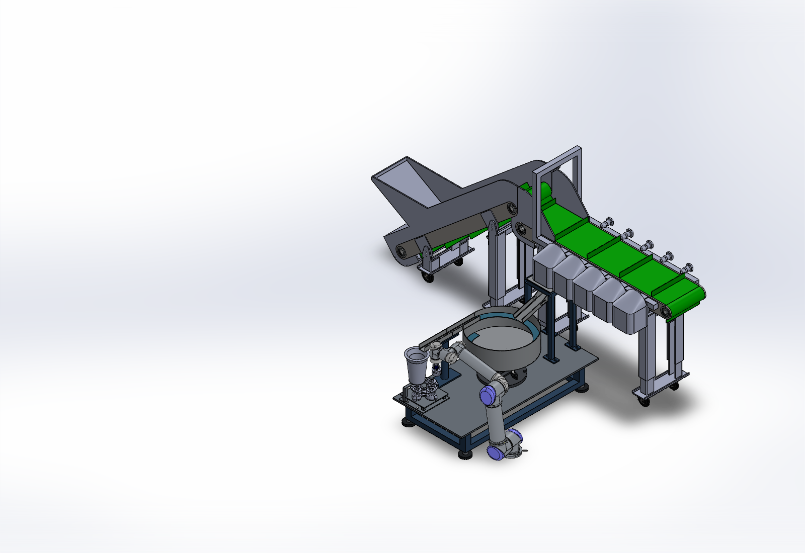
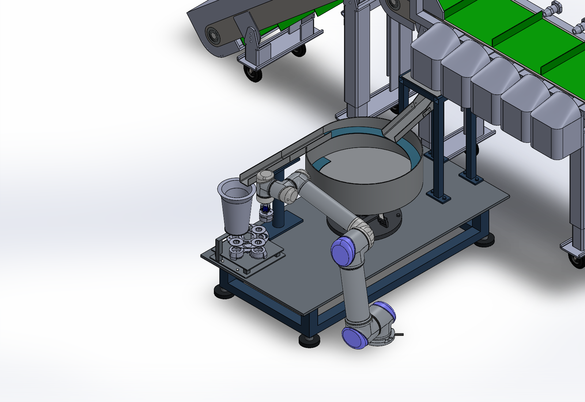

# Tube Feeder CAD

Updated SolidWorks CAD for the tube-sorting system, bowl feeder, Chengyi tube holder and robot integration. This repository is separate from the thesis and simulation repository.

## Download and open

1. [Download the complete CAD package (ZIP)](https://github.com/Yuquan66/Tube-Feeder-CAD/archive/refs/heads/main.zip).
2. Extract the entire ZIP before opening any assembly.
3. Open [`CAD/Main Assembly.SLDASM`](CAD/Main%20Assembly.SLDASM) in **SOLIDWORKS 2025 or a compatible later version**.

All referenced external CAD files are collected in the `CAD` directory using SolidWorks Pack and Go. Keep them together; downloading the main assembly alone is not sufficient. Virtual components remain embedded in their parent assembly.

Useful subassemblies:

- [`Bowl Feeder.SLDASM`](CAD/Bowl%20Feeder.SLDASM)
- [`Chengyi Tube Holder.SLDASM`](CAD/Chengyi%20Tube%20Holder.SLDASM)
- [`UR5.SLDASM`](CAD/UR5.SLDASM)

## Current design

- One bowl-feeder installation connected to the existing sorting assembly.
- Chengyi's tube holder integrated downstream of the linear feeder.
- Complete 360-degree guide tube; the 180-degree cutaway is removed. The inherited filename `pipe - half.SLDPRT` is retained to keep existing references consistent.
- Robot base positioned beside the platform at floor level, rather than on the tabletop.
- Original small conveyor remains suppressed in the main assembly, with its referenced files included.

## Preview

## Package checks and scope

The publication package was reopened in SolidWorks 2025 SP4 without missing-reference opening errors. The restored guide tube and floor-level robot placement were checked in the packaged assembly.

This is an editable CAD design snapshot, not a certified manufacturing or robot-motion release. Full operating trajectories, tube feeding performance, structural strength and manufacturing tolerances are not validated by this package.

The repository contains CAD files, previews and this opening guide. It does not contain the thesis, datasets, trained models, private correspondence or local automation scripts. `SHA256SUMS.txt` records the published CAD and preview file checksums.

## Component attribution

The tube-holder and gripper components were supplied through Chengyi and the project collaboration; the related public project is [Soft-Gripper-](https://github.com/a2597182460-lgtm/Soft-Gripper-). Robot, camera and other purchased-component models are retained from the source assembly. Original component authorship and rights are retained; this repository does not grant a new blanket licence for third-party CAD. Native files may retain their original CAD authoring metadata.
